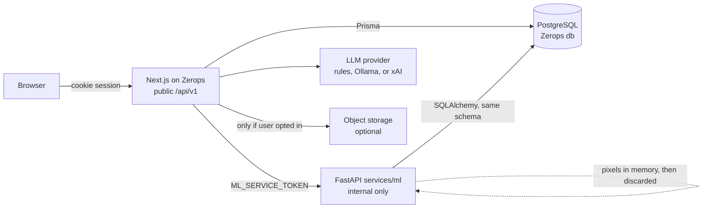
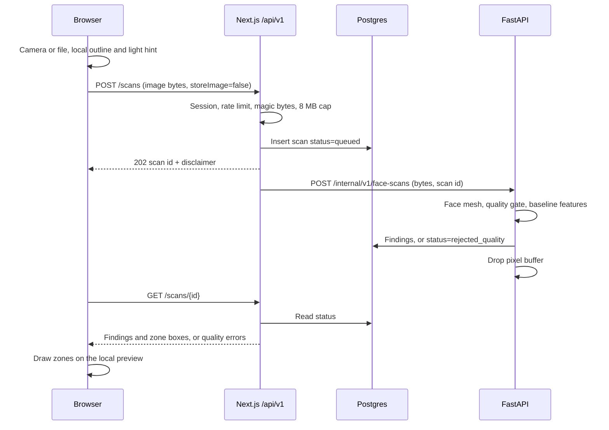

# RiRu architecture

Phase 0 contract. See [phase-0.md](phase-0.md) for the decisions this file depends on.

## System context



The browser talks only to Next.js. FastAPI is a private service on the same private network. Postgres is the one shared database. Object storage is absent until configured, and the default path never calls it.

## Request paths

### Face scan



Polling interval is 1 second, client stops after 60 seconds and shows a still-running state with a retry. The job is idempotent on `Idempotency-Key`: the same key and user return the original scan id.

If FastAPI is unreachable, Next.js marks the scan `failed` with code `ML_UNAVAILABLE`. It does not silently run `generateScan` and present those numbers as the analysis. The old `POST /api/scans` heuristic remains only on the legacy route until Phase 2 removes it from the scan screen.

### Ingredient label

The browser sends a photo or typed text to `POST /api/v1/ingredients/scan`. Next.js stores the row as `queued` and forwards bytes to FastAPI. FastAPI preprocesses (grayscale, contrast, threshold, deskew when the library can) and runs OCR. The OCR string is untrusted data. It is stored in `ingredient_scans.ocr_text` and is never pasted into a system prompt except inside a delimited untrusted block.

Normalization is deterministic TypeScript in `packages/shared`: uppercase, strip punctuation, join line-break hyphens, then fuzzy match to INCI names in `data/ingredients`. Below the match threshold the token stays `unparsed` and the verdict cannot be "Good fit".

`POST /api/v1/ingredients/analyze` runs the YAML rule pack for the caller's profile and returns `good_fit`, `caution`, or `avoid` plus the rule ids that fired.

### Recommendations and prices

`POST /api/v1/recommendations` runs in the Next.js server against the latest succeeded scan, the profile, and `data/routines`. It writes `routines` and `routine_steps`. Product suggestions come from the seeded catalog in `data/products`, filtered by allergies, fragrance, pregnancy, budget, and recovery mode.

Prices go through `PriceProvider`:

| Provider | Role | Network behavior |
|---|---|---|
| `manual` | Default. Stores a URL, amount, and currency the user submits. | No fetch of the retailer page. |
| `official` | Optional later. A named retailer API the project has a key and a terms review for. | Only that API's documented endpoints. |

HTML scraping of Amazon, Nykaa, Flipkart, or similar is out of scope. It breaks often, and it often violates those sites' terms. A contributor adds a provider by implementing the interface and documenting the terms review in `docs/price-providers.md` (created with the first official provider, not before).

### Chat

Phase 5. Shape, so later phases do not invent a second one:

1. Next.js loads the session and, if the user allowed it, the latest scan summary and profile.
2. FastAPI embeds the question with `all-MiniLM-L6-v2` (384 dimensions) and returns the top knowledge chunks plus scores.
3. If the best score is under the threshold, the reply is "I'm not sure" and a suggestion to see a professional when the topic is medical. No model invention.
4. Next.js streams tokens from the configured LLM provider. The prompt says the model is not a doctor, must cite chunk ids, and must treat user text and OCR text as data.
5. The stored assistant message includes the chunk ids it was given.

Until Phase 5, legacy `/api/chat` keeps today's rules and optional xAI call. New `/api/v1/chat` is not exposed before retrieval exists. Shipping an ungrounded chatbot on the new contract would hide the limit.

### Privacy export and delete

`GET /api/v1/me/export` returns one JSON document for the signed-in guest or account: profile, scans and findings, routines, ingredient scans, chat, feedback the user filed, consent log. Image objects are included only as expired-or-present flags, not as long-lived public URLs.

`DELETE /api/v1/me/data` deletes the user row. Foreign keys use `ON DELETE CASCADE`. Object storage deletes any image refs first. The consent log entry that records the deletion is written to an append-only `deletion_receipts` row that contains no profile fields, only a timestamp and a request id, so we can show "your delete completed" without keeping the profile.

## Processes and deploy

Local:

```text
docker compose
  postgres   pgvector/pgvector:pg16     host port 5432
  ml         services/ml                host port 8000, internal
  web        existing Next.js           host port 3000
```

Zerops, production, unchanged entry:

- Build and start stay in `zerops.yaml` (`output: 'standalone'`, port 3000, `node migrate.cjs` once per version).
- The ML service is a second Zerops service when Phase 2 needs it. Until that service exists, `/api/v1` scan routes return `ML_UNAVAILABLE` rather than fake scores.
- Readiness for the web container stays `GET /`. Do not point the Zerops readiness check at the ML service.

Paid versus free:

| Piece | Free path | Paid optional |
|---|---|---|
| Web + Postgres | Current Zerops services | Larger Zerops containers |
| Vectors | pgvector, or brute-force cosine over a few hundred chunks | Managed vector DB |
| OCR | Tesseract in the ML image | PaddleOCR, same interface, larger image |
| Face gate | MediaPipe Face Landmarker, Apache-2.0 | None planned |
| Skin scores | Classical CV baseline, confidence capped | A fine-tune only after a dataset license is written down |
| Embeddings | `sentence-transformers/all-MiniLM-L6-v2` on CPU | Hosted embedding API |
| LLM | Built-in rules, or Ollama on the developer's machine | xAI when `XAI_API_KEY` is set |
| Object storage | Off. Pixels discarded | Supabase Storage or S3-compatible, private bucket |
| Auth | First-party guest cookie | Email or OAuth later, still optional for core features |
| Errors | Structured JSON logs | A Sentry-compatible DSN if `SENTRY_DSN` is set |

## Repository layout

Target after Phase 1. The Next.js app stays at the root.

```text
Project---RiRu/
  app/                      existing App Router (stays)
  components/               existing UI (stays)
  lib/                      existing db, scan-engine, chat-engine (stays until replaced)
  migrate.js                Zerops migration entry (extended, not replaced)
  zerops.yaml
  package.json
  docs/                     this design
  packages/shared/          zod types, JSON schemas, rule engine, INCI normalizer
  services/ml/              FastAPI: face gate, baseline CV, OCR, embeddings
  data/
    ingredients/            INCI records, one file per letter or one JSON array
    rules/v1/               conflict and caution rules
    routines/               AM/PM templates
    products/               seed catalog, not a scrape
    knowledge/              markdown sources for RAG
  messages/                 en.json, then hi.json and ta.json
  docker-compose.yml
  .env.example
  .github/workflows/ci.yml
```

`Project---RiRu.git` is the bare mirror. It is not a second source tree. Do not edit files inside it.

Why the web app stays at the root: `zerops.yaml` runs `npm ci` and `next build` in the repo root and deploys `.next/standalone`. Moving the app to `apps/web` in the same step as new features would mix a deploy-path change with product work. A later cutover can set the Zerops build root to `apps/web` once the new layout has already shipped.

## Ownership of code

| Concern | Owner | Why |
|---|---|---|
| HTTP for the browser, sessions, streaming chat | Next.js route handlers | Already the public origin. One cookie domain. |
| Schema, seeds, app CRUD | Prisma, invoked from `migrate.js` | One migration history. Matches the spec's recommendation. |
| Face, OCR, embeddings | FastAPI | Python has the libraries. Keeps the Next.js standalone image smaller. |
| Conflict rules, routine builder, INCI match | `packages/shared` (TypeScript) | Must run even when the ML container is down. Same YAML the Python side reads for tests. |
| Catalog and knowledge files | `data/` | Contributors edit data, not Python. |

FastAPI models that touch tables are a thin reflection of the Prisma schema. CI checks that internal response models match `packages/shared` JSON schemas. Phase 1 adds that check as a fixture test, even if the service still returns a health payload only.

## Data model

Full tables, SQL, and the mapping from today's `migrate.js` are in [data-model.md](data-model.md). The Prisma file is [schema.prisma](schema.prisma). It is the target. Phase 1 applies additive SQL only.

Legacy rows stay valid:

- `skin_scans.metrics`, `concerns`, and `ingredients` JSON stay.
- New analysis writes those JSON blobs and normalized `scan_findings`, so the current dashboard can read either.
- `analysis_kind` tells the UI which writer produced the row.

## Public API

The contract is [openapi.yaml](openapi.yaml). Summary:

| Method | Path | Auth | Notes |
|---|---|---|---|
| POST | `/api/v1/scans` | Guest or account | `202`, idempotent |
| GET | `/api/v1/scans/{id}` | Owner | Poll status |
| GET | `/api/v1/scans` | Owner | History, cursor |
| DELETE | `/api/v1/scans/{id}` | Owner | Deletes findings and image ref |
| POST | `/api/v1/ingredients/scan` | Guest or account | `202` |
| GET | `/api/v1/ingredients/{inci}` | Guest or account | Public catalog |
| POST | `/api/v1/ingredients/analyze` | Guest or account | Rule verdict |
| POST | `/api/v1/recommendations` | Guest or account | Writes a routine |
| GET | `/api/v1/recommendations/{id}` | Owner | |
| GET | `/api/v1/products/search` | Guest or account | Local catalog |
| GET | `/api/v1/products/{id}/prices` | Guest or account | Manual listings |
| GET | `/api/v1/products/{id}/alternatives` | Guest or account | Ingredient overlap |
| POST | `/api/v1/chat` | Guest or account | SSE, Phase 5 |
| GET | `/api/v1/chat/sessions` | Owner | |
| GET | `/api/v1/profile` | Owner | |
| PUT | `/api/v1/profile` | Owner | |
| POST | `/api/v1/profile/recovery-mode` | Owner | |
| POST | `/api/v1/feedback` | Guest or account | |
| GET | `/api/v1/me/export` | Owner | JSON download |
| DELETE | `/api/v1/me/data` | Owner | Cascade delete |
| POST | `/api/v1/consent` | Owner | Camera, storage, training opt-in |

Error body, every non-2xx JSON response:

```json
{
  "error": {
    "code": "SCAN_QUALITY_REJECTED",
    "message": "No face was detected.",
    "details": { "reasons": ["no_face"] }
  }
}
```

`message` is safe to show in the UI. It is not a stack trace.

Rate limits, enforced in Next.js with counters on the user row's window in Postgres (no Redis):

| Action | Guest | Account |
|---|---|---|
| Face scans | 8 / day | 30 / day |
| Ingredient scans | 20 / day | 60 / day |
| Chat messages | 30 / hour | 120 / hour |
| Export | 4 / day | 10 / day |
| Feedback | 10 / day | 30 / day |

Over the limit: `429` with `Retry-After`. Limits are per user id, so a new guest cookie is a new budget. Phase 1 also caps new guest users per IP at a low number to slow abuse. That cap is coarse and will misfire on shared NATs. It is a basic control, not a complete one.

Auth rules:

- Missing or invalid session on an owner route: `401`.
- Session that does not own the row: `404`, so we do not reveal that another user's id exists.
- Public catalog reads (`GET /ingredients/{inci}`, product search) still require a session so the rate limit has a key. Creating that session is automatic on first visit and is not an account.
- FastAPI rejects any request without `Authorization: Bearer ${ML_SERVICE_TOKEN}`.
- CORS allows the web origin only. The ML port is not listed.

## Vision pipeline (Phase 2)

This is the plan the service will implement. It is a baseline, not a clinical device.

1. **Detect and align.** MediaPipe Face Landmarker (face mesh). Require one face. Reject multiple faces, no face, face box under 20 percent of the frame, or yaw/pitch outside a fixed range so a profile shot cannot produce scores.
2. **Quality gate.** Reject when mean luminance is outside a band, when the Laplacian variance of the face crop is below a blur threshold, or when the face is clipped by the frame. Thresholds are constants in code, chosen on a small set of developer photos, and the model card says they are not clinically validated. A rejected scan stores the reason and no concern scores.
3. **Segment.** The face oval from the mesh is the skin region. Eyes, lips, and nostrils are excluded with landmark polygons. This is a geometric mask, not a trained skin segmenter.
4. **Features, classical, on the masked crop.**
   - Redness: mean a* in CIE Lab on cheeks versus a neutral reference band.
   - Shine versus dullness: highlight ratio on the T-zone versus the cheeks. This is the oily / dry / combination / normal heuristic.
   - Texture: Laplacian variance inside cheek patches.
   - Dark circles: mean luminance under the eyes versus the cheeks.
   - Spots: local contrast blobs inside the mask. Location only. No benign/malignant label.
   - Pores and fine lines: high-frequency energy. Easy to confuse with image noise. Confidence stays low.
   - Dehydration: not directly visible. Inferred only as a weak combination of dullness and fine texture, confidence capped, copy says it is a guess.
   - Sensitive: not classified from pixels. Taken from the profile when the user says so. Redness can add a caution. It cannot assign the sensitive type by itself.
5. **Output policy.** Each concern has severity `none | mild | moderate | severe` and a confidence in `[0, 1]`. `baseline_cv_v1` caps confidence at `0.55`. Severity `severe` always attaches escalation copy and does not attach a product. Skin type confidence uses the same cap.
6. **Overlay.** Findings include normalized boxes or polygons in face-crop coordinates (`0..1`). The client draws them on the image it already has. The server does not need the photo to render history. History without a stored photo shows the zone name and the trend, and says the picture was not kept.
7. **Fallback.** If the quality gate fails, status is `rejected_quality`. If the service crashes, status is `failed`. Neither path fills in heuristic scores.

### What we will not claim

No disease name. No Fitzpatrick measurement from the model. The profile may store a self-described tone range later so evaluation can be stratified. Self-description is not a clinical Fitzpatrick label, and the model card must say that.

### Training plan, only after a license is written down

A fine-tune is optional and is not on the MVP critical path. Candidate datasets and the block on each:

| Dataset | Why it is interesting | Block |
|---|---|---|
| ACNE04 | Acne severity images used in papers | License for redistribution and for an open-source app is not verified. Do not download it into this repo until it is. |
| Fitzpatrick17k | Tone-stratified lesion photos | Source-image licenses are mixed. Not approved. |
| SD-198 | Skin disease classes | Research use needs a written license check. Not approved. |
| DermNet | Large dermatology atlas | Not an open training set. Do not use. |

Until one of those is replaced by a dataset with a license file we can ship, there is no training run. Phase 7's evaluation report will say "not measured" for any group we do not have rights and labels for. Inventing per-tone F1 is forbidden.

The training script, when a dataset is approved, belongs in `services/ml/training/` with a held-out split, a metric report per concern, and a slice by the dataset's own tone labels if they exist. That script is Phase 7 work, and only if the license gate has passed. The model card template is [model-card.md](model-card.md).

### OCR plan (Phase 3)

Default engine is Tesseract (`eng`) behind `OcrProvider`. Preprocessing uses Pillow and OpenCV if OpenCV's wheel is acceptable in the image size budget. If the image gets too large for the free container, preprocessing stays on Pillow only. PaddleOCR implements the same interface and is off unless `OCR_PROVIDER=paddle`. Both are Apache-2.0. Accuracy on curved bottles will be mediocre. The UI shows the raw OCR text for the user to fix before analysis. A verdict is computed from the edited text, not from the raw OCR alone, once the user confirms.

### Embeddings (Phase 5)

`all-MiniLM-L6-v2`, 384 dimensions, local CPU, Apache-2.0. Chunks are about 800 characters of the curated markdown in `data/knowledge`, with source path and heading stored on the row. Ingest is idempotent on `(source, content_hash)`.

Query-time: cosine distance. If `CREATE EXTENSION vector` succeeds, use an HNSW index. If it does not, store `double precision[]` and rank in the ML process. A few hundred chunks make the fallback acceptable. This limit is recorded in the model card and the risks.

## Safety

- Consent screen before the first camera open. Recorded in `consent_log` with purpose `camera_analysis`. Separate consent for `store_image` and for `training_opt_in`. Training opt-in defaults off, and the MVP has no training job that reads user photos even if someone opts in. The flag is stored so a future job can honor it. The future job must check the flag. There is no silent use.
- TLS at the Zerops public edge. Postgres stays on the private network. Image buckets, when added, are private and served with signed URLs that expire in 10 minutes.
- Uploads: JPEG, PNG, WebP only, checked by magic bytes, max 8 MB. The file name is ignored. No SVG. The ML process does not shell out to a decoder with the user string.
- OCR and chat text are untrusted. The system prompt is a fixed template. User and OCR content are placed in a single user message labeled as untrusted. The model is instructed to ignore instructions inside that block. This reduces prompt injection. It does not eliminate it. High-risk replies (dosing, diagnosis) are also blocked by a response checker that looks for dose patterns and diagnosis phrasing and replaces them with the refusal line.
- Secrets only in env vars. `.env.example` lists names with empty values. `XAI_API_KEY` and `ML_SERVICE_TOKEN` are never sent to the browser.
- CSP on the Next.js app: `default-src 'self'`; images from `blob:` for the local preview; no third-party script in the MVP.
- Dependency review: `npm audit` and `pip audit` in CI. Fail on high severity once the lockfiles exist. Phase 1 starts with report-only if the current tree already has findings, and writes them into the Phase 1 summary rather than hiding them.
- OWASP baseline we are designing for: broken access control (owner checks), cryptographic failures (TLS, no pixels at rest by default), injection (parameterized SQL, OCR treated as data), insecure design (quality gate, medical limits), security misconfiguration (private ML port, CSP), vulnerable components (audit in CI), identification failures (guest cookie is random, httpOnly, SameSite=Lax, not the demo user id), software and data integrity (lockfiles), logging (no image bytes and no raw OCR in info logs), SSRF (the manual price provider does not fetch the URL).

GDPR and India's DPDP Act, as product rules, not as legal advice: identify a purpose on the consent screen, collect the profile fields the recommendation needs, do not sell data, do not use photos to train without opt-in, offer export and delete, and do not keep guest rows that have been idle for 30 days. A privacy-policy template is a Phase 7 document. This design is not a compliance certificate.

## UI map

Existing screens stay until the phase that replaces them.

| Screen | Phase | Notes |
|---|---|---|
| Landing (`app/page.tsx`) | later polish | Add disclaimer and "photos are not stored" |
| Scan (`components/ScanFlow.tsx`) | 2 | Outline, quality messages, results, heatmap on the local image |
| Dashboard | 6 | Becomes progress. Until then it may show legacy heuristic rows, labeled |
| Routine | 4 | Real rule output |
| Chat | 5 | Streaming, citations, low-confidence refusal |
| History | 6 | Compare and charts |
| Onboarding, ingredient scanner, product detail, settings, about | 3 to 7 | New routes |

Visual direction: mobile first, the current calm layout as the starting point, light and dark, WCAG AA contrast, focus rings, no guilt copy on missed routine days ("No check-in — that is fine"). Illustrations, when added, use a range of skin tones. Stock photos of a single skin tone are not enough for empty states.

i18n: user-facing strings move to `messages/en.json` as screens are touched. Do not wrap the whole legacy UI in one pass during Phase 1.

## Observability

JSON logs to stdout: `time`, `level`, `request_id`, `user_id`, `route`, `code`. Do not log image bytes, OCR text, chat content, or emails at `info`. Errors log the exception class and the stable error code. Optional `SENTRY_DSN` sends the same redacted event. Metrics for the MVP are counters in logs: scan status, quality-reject reason, OCR duration, LLM provider name. No metric includes free text from the user.

## Environment variables

Existing, still required on Zerops:

```text
DB_HOST
DB_PORT
DB_USER
DB_PASS
DB_NAME
NODE_ENV
```

Added by Phase 1 (empty is a documented behavior, not a crash of the current pages):

```text
DATABASE_URL                  # postgresql:// user:pass @ host:port / db  — Prisma
DEMO_MODE                     # true keeps the shared Maya seed on screen
SESSION_SECRET                # signs the guest cookie
ML_SERVICE_URL                # empty means scans return ML_UNAVAILABLE
ML_SERVICE_TOKEN
OCR_PROVIDER                  # tesseract (default) or paddle
LLM_PROVIDER                  # rules (default), ollama, or xai
OLLAMA_BASE_URL               # default http://127.0.0.1:11434
XAI_API_KEY                   # only if LLM_PROVIDER=xai
EMBEDDING_MODEL               # sentence-transformers/all-MiniLM-L6-v2
STORAGE_PROVIDER              # none (default), s3, or supabase
STORAGE_BUCKET
STORAGE_SIGN_TTL_SECONDS      # default 600
SUPABASE_URL                  # only if STORAGE_PROVIDER=supabase or a future auth adapter
SUPABASE_SERVICE_ROLE_KEY
SENTRY_DSN                    # optional
GUEST_RETENTION_DAYS          # default 30
```

`DATABASE_URL` is derived from `DB_*` in `zerops.yaml` when Phase 1 updates that file, so the Zerops dashboard does not need a second copy of the password beyond the reference it already injects.
